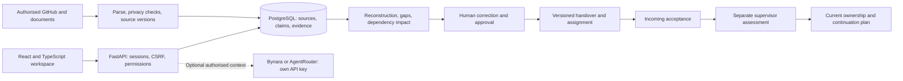

# INHERIA

**People leave. Knowledge lives on.**

INHERIA helps a technical team transfer project knowledge and responsibilities when someone leaves or changes roles. It brings authorised documents and repository activity into one workspace, reconstructs source-linked knowledge, highlights uncertainty, supports human review and gives the incoming person a practical continuation plan.

**[Open the live product](https://inheria.onrender.com)** · **[Judge scenario guide](https://inheria.onrender.com/demo)** · **[API documentation](API_CONTRACT.md)** · **[Verification evidence](docs/verification.md)**

**Journey:** Connect → Reconstruct → Verify → Review → Handover → Accept & Validate → Continue


*Current live ShopEase judge workspace. Screenshots were captured on 14 November 2026 in an isolated public case-study workspace.*

## Tech stack

<p align="center">
  <b>Frontend</b><br/>
  
  
  
  
  
  
</p>

<p align="center">
  <b>Backend</b><br/>
  
  
  
  
  
</p>

<p align="center">
  <b>Data</b><br/>
  
  
  
</p>

<p align="center">
  <b>Deployment and quality</b><br/>
  
  
  
  
  
  
</p>

## Contents

[Try it as a judge](#try-it-as-a-judge) · [The problem](#the-problem-and-the-shopease-case-study) · [How it works](#how-it-works) · [Tech stack](#tech-stack) · [Features](#key-features) · [Three improvements](#three-submitted-improvements) · [Optional AI](#optional-ai-bring-your-own-api-key) · [Architecture](#architecture) · [Run locally](#run-locally) · [Testing](#testing-and-reliability-evidence) · [Privacy and security](#privacy-and-security) · [Known limits](#known-limits) · [Docs](#documentation) · [Deployment and licensing](#deployment-and-licensing)

## Try it as a judge

Open **[inheria.onrender.com](https://inheria.onrender.com)** and choose an option beside sign-in:

| Entry | What you can test |
| --- | --- |
| **Open judge workspace** | The completed ShopEase handover: 51 sources, 81 claim records, eight accepted responsibilities, eleven reviewed knowledge walkthroughs and an evidence-backed graph. |
| **Try a fresh handover** | Start with 13 sources and an unapproved transition, then perform reconstruction, review, handover, acceptance and validation yourself. |
| **Explore demo** | Read the scenario and role guide first. |
| **Create an account** | Create your own organisation, project and authorised sources. |

- **No email, password or API key is required** for the core judge workflow.
- Each visitor gets a separate, expiring workspace (four hours by default). Role switching is limited to that visitor's three case-study identities and cannot reach real accounts.
- Render Free can take about a minute to wake after inactivity. Free hosting also has finite quotas, including Neon's 5 GB monthly database transfer budget ([details](docs/deployment.md#database-transfer-budget)).
- The ShopEase example uses authored demonstration material, not Wipro/client records. Completed-mode approvals are recorded case-study history, not actions performed by the visitor.

<details>
<summary>Screenshot: judge access beside sign-in</summary>


</details>

## The problem and the ShopEase case study

A departing DevOps engineer may know the deployment sequence, rollback restrictions, incident workarounds, backup ownership and the reasons behind architecture decisions. Those details are split across runbooks, repository history and personal experience, so a folder of files leaves questions about relevance, freshness, permissions and ownership.

INHERIA turns those sources into **reviewable knowledge**. The successor inspects the original evidence, sees unresolved questions, accepts responsibility and completes a supervisor-reviewed exercise. The coordinator sees which steps are done and which prerequisites still block completion.

**ShopEase: Gaurav → Savinay, coordinated by Rudransh.** A shopping-application DevOps case study covering releases, deployment troubleshooting, infrastructure, monitoring, rollback, backup/recovery, access coordination and incident response.

| Person | Role | Main actions |
| --- | --- | --- |
| **Gaurav** | Departing DevOps engineer | Reviews responsibilities, supplies missing explanations and corrects project knowledge. |
| **Savinay** | Incoming DevOps engineer | Reviews the handover, requests missing access, accepts or rejects ownership and submits cited validation work. |
| **Rudransh** | Administrator / coordinator | Connects sources, manages membership, assigns responsibilities and records closure after required checks pass. |

**Example:** an old deployment guide disagrees with the current pipeline. INHERIA keeps both sources and flags the conflict. Gaurav supplies an explanation, another authorised reviewer verifies it, and Savinay reviews the approved procedure, accepts the release responsibility and submits a cited deployment walkthrough. If recovery evidence is missing or an exercise is rejected, the handover stays actionable through correction and revalidation.

## How it works

| Step | What happens |
| --- | --- |
| **1. Connect** | Upload PDF, DOCX, Markdown, TXT or JSON files, or connect a public GitHub repository or an authorised private one (encrypted PAT). |
| **2. Reconstruct** | Investigate sources for project state, responsibilities, decisions, procedures, dependencies, incidents and unfinished tasks. |
| **3. Verify** | Inspect exact quotations and document/page/line references; flag missing, stale, conflicting or uncertain information. |
| **4. Review** | An authorised reviewer approves, rejects or corrects claims. Employee explanations require another reviewer. |
| **5. Handover** | Create the transition, generate the report, approve its current version and assign incoming/backup owners. |
| **6. Accept & validate** | The successor accepts or rejects responsibility and submits cited scenario work. A separate supervisor reviews it. |
| **7. Continue** | Close when required gates pass; record current ownership and show the successor's continuation view. |

**Completion** depends on current approved evidence, incoming acceptance, supervisor-reviewed tasks and required readiness checks. Recording a critical-gap follow-up keeps the underlying issue open: a completed knowledge transfer does not mean every production incident is solved. Changed or revoked evidence can remove readiness, and active handovers support reopening, correction, reapproval and renewed acceptance.


*Completion is recorded across the workspace, with ownership, version history and participant contributions.*


*The incoming person can find assigned responsibilities and approved procedures, then inspect their citations.*

## Key features

- **Accounts and access:** organisation/project membership, expiring single-use invitation links, access requests with separate approval, revocation and audit history. Source ACLs stay enforced for administrators and derived knowledge.
- **Ingestion:** GitHub REST/PAT connector with incremental sync, five document formats, locators and ACL-safe duplicate detection.
- **Evidence-first intelligence:** English prose/structured extraction of responsibilities, decision rationale, dependencies and unresolved work, always with exact quotations.
- **Graph and risk views:** cited people/project/system/knowledge graph, cycle-safe dependency paths and hypothetical risk scenarios.
- **Human review:** approval, rejection, correction, conflicting-decision review and source freshness checks.
- **Source-change investigation:** document replacement, downstream impact, revocation, evidence invalidation and resumable investigation checkpoints.
- **Practical validation:** deployment-review, rollback-readiness and recovery-evidence criteria with separate supervisor assessment and closure gates. INHERIA executes no production commands.
- **Optional Digital Successor:** private saved conversations with citations, Low/High effort and confirmed project actions.

See the [feature/status matrix](docs/feature-status.md) for implemented, partial and postponed items.

### Screenshots: evidence, dependencies and practical review


<details>
<summary>Connected sources, original evidence and supervisor validation</summary>

**Connected source inventory**


**Original source evidence**


**Reviewed practical transfer**


</details>

<details>
<summary>Day theme and mobile continuation view</summary>


</details>

## Three submitted improvements

| Improvement | What changed for the user |
| --- | --- |
| **1. Secure Team Onboarding & Access Readiness** | Incoming employees choose their password through a single-use expiring invite, request missing access and see reviewer decisions. Administrators revoke invitations/membership with audit records. |
| **2. Investigation & Source-Change Intelligence** | Prose reconstruction gains exact owner/rationale/dependency spans. Source replacement/removal exposes downstream impact, and interrupted investigations resume from checkpoints without duplicate candidates. |
| **3. Practical Transfer Validation & Recovery** | Responsibility-specific deployment, rollback and recovery criteria, cited staging records, rejected/reopened transfer recovery and traceable reapproval. Submissions and assessments stay separate. |

The dedicated acceptance run passed **34/34 journeys**. See the [promise-to-delivery map](docs/three-improvements-acceptance.md) and [test record](docs/three-improvements-tests.json) for denominators and limits. Conversational chat is additional functionality.

**Changes from the original proposal:** the broad eleven-engine vision was narrowed to the source-to-handover journey. GitHub REST/PAT is delivered, while OAuth/webhooks and other connectors remain future work. Deterministic extraction keeps the core workflow usable without paid AI. Predictive scores, cross-company learning and a general workflow builder were postponed.

## Optional AI: bring your own API key

**To use generated conversational answers, insert your own authorised provider API key.** The judge workspace does not inherit another account's key. The core workflow and labelled evidence retrieval work without one.

| Setting | Value |
| --- | --- |
| Provider option | **Bynara · router.bynara.id** |
| Endpoint | `https://router.bynara.id/v1` |
| Model | `agnes-2.5-flash` |
| Protocol | **Chat Completions** |

1. Sign in as your organisation's **administrator** (in the judge example, Rudransh).
2. Open **Digital successor → AI settings**.
3. Select **Bynara · router.bynara.id**, `agnes-2.5-flash` and **Chat Completions**.
4. Enter your Bynara API key in **Provider API key**.
5. Enable **external AI processing for authorised users**, then **Save settings**.
6. Select **Test saved connection**, then ask a question with **Low effort** or **High effort**.


- The server needs `INHERIA_TOKEN_ENCRYPTION_KEY` to store a key. Keys are encrypted on the backend and never returned to the browser.
- On provider failure, the conversation is preserved and labelled evidence retrieval is shown instead of an invented answer.
- One live reply returned two citations in 66.4 seconds, but a broader 50-question run returned valid provider replies for only 9/50 primary questions, so universal availability or accuracy is not established. See [chat setup](docs/chat-integration-plan.md) and the [evaluation record](docs/four-workstream-acceptance.md).
- **AgentRouter** remains available for existing configurations; it is a separate service from Bynara.

## Architecture

INHERIA is a **modular monolith**: one FastAPI backend serves the built React frontend and applies shared permission/evidence rules, with durable state in PostgreSQL (SQLite for local development, Alembic migrations).



A separate vector store, graph database and distributed worker were deliberately omitted: for this bounded workflow they add operating complexity without solving the central handover requirement. See [architecture and trust boundaries](docs/architecture.md).

### Repository structure

```text
backend/app/          API, permissions, ingestion, intelligence and transfer services
backend/migrations/   Alembic database migrations
backend/tests/        API, permission, lifecycle and PostgreSQL transaction tests
backend/evaluation/   Labelled corpora and evaluation runners
frontend/src/         Workspace pages, shared UI, themes and API client
frontend/tests/       Playwright journey, failure and accessibility checks
docs/                 Architecture, verification, setup and roadmap
```

## Run locally

**Requirements:** Python 3.13 (3.12+ supported), [uv](https://docs.astral.sh/uv/), Node 24 with npm and a current browser.

```powershell
git clone https://github.com/Gauravwakle96/INHERIA.git
cd INHERIA
```

**1. Start the API**

```powershell
cd backend
uv sync --frozen
Copy-Item .env.example .env
uv run alembic upgrade head
uv run uvicorn app.main:app --host 127.0.0.1 --port 8010
```

**2. Start the frontend** (second terminal, from the repository root)

```powershell
cd frontend
npm ci
npm run dev -- --host 127.0.0.1 --port 5173
```

**3. Open** **http://127.0.0.1:5173** (interactive API docs at **http://127.0.0.1:8010/docs**).

Default local settings use SQLite, a labelled Nexora development scenario and a separate ShopEase judge walkthrough. You can also register a new organisation, invite members from **Knowledge owners** and upload permitted documents under **Connected sources**.

**Key environment variables** (full list in [backend/.env.example](backend/.env.example) and [deployment docs](docs/deployment.md)):

| Variable | Purpose |
| --- | --- |
| `INHERIA_DATABASE_URL` | SQLite development URL or PostgreSQL/psycopg URL with TLS for deployment. |
| `INHERIA_ENVIRONMENT` | `development` or `production`. Production requires PostgreSQL and HTTPS origins. |
| `INHERIA_ALLOWED_ORIGINS` | JSON array of exact permitted origins for writes. |
| `INHERIA_TOKEN_ENCRYPTION_KEY` | Stable Fernet key for private GitHub and organisation AI credentials; never commit it. |
| `INHERIA_JUDGE_DEMO_ENABLED` | Enables visitor-isolated judge workspaces. |

## Testing and reliability evidence

**228 backend tests passed**, including **15 real PostgreSQL transaction cases**, with **90% line coverage**. [CI run 43531873055](https://github.com/Gauravwakle96/INHERIA/actions/runs/43531873055) passed backend lint/format/tests/dependency audit and frontend lint/typecheck/build/npm audit.

| Area | Evidence |
| --- | --- |
| Main workflow | Ingestion, reconstruction, citation inspection, review, handover approval, acceptance, assessment, recovery gates and closure. |
| Permissions | Tenant/visitor isolation, source ACLs, restricted evidence denial, revocation and derived-history filtering. |
| Concurrency | Separate PostgreSQL sessions with real lock waits for duplicate acceptance/assignment/closure, source/access changes and invitation races. |
| Failure and recovery | Invalid files, quarantine, stale evidence, connector retries, rejected/reopened tasks, checkpoint resume and process restart. |
| Browser / accessibility | 390/768/1440px checks, day/night themes, keyboard/reduced-motion checks and zero automated axe A/AA findings in the recorded bounded runs. |

**Extraction:** a 72-document all-prose first run measured precision 94.6% and recall 88.3%. After general fixes, its now-known regression cases measure precision 100% and recall 98.3%. The original report remains published. These are internally authored labels and tuned regression results, **not independently measured enterprise accuracy**. No independent five-person usability verification is claimed.

```powershell
# backend
uv run ruff check app tests
uv run pytest -q --cov=app
uv run pip-audit --local

# frontend
npm run lint
npm run typecheck
npm run build
npm run test:e2e
```

Without `INHERIA_TEST_POSTGRES_URL` (a loopback PostgreSQL database whose name ends in `_qa`), the PostgreSQL tests skip explicitly. See [reproduction details](docs/postgres-and-extraction-hardening.md) and the full [verification history](docs/verification.md).

## Privacy and security

- **Permission-aware:** backend organisation/project/source checks apply to documents, claims, graph relationships, handovers, saved answers and derived evidence.
- **Traceable:** important knowledge keeps exact quotations, source version and human verification state. Missing information stays missing.
- **Secrets:** private tokens and provider keys are encrypted server-side; sessions are opaque HttpOnly cookies with CSRF/origin checks; probable secrets are quarantined and selected PII is redacted before indexing.
- **Human oversight:** successors accept their own responsibilities, another reviewer assesses practical work, and chat actions need confirmation. Knowledge access does not grant AWS, IAM or other external-system permissions.

Pattern-based privacy checks can miss sensitive information, and encryption at rest, backups and compliance need deployment-specific controls.

## Known limits

- **Prose extraction** covers English patterns only; pronoun-only ownership and shared attribution can remain unresolved.
- **Connectors:** GitHub REST/PAT snapshots are bounded and marked partial. OAuth/webhooks and Jira/Slack/Teams/Confluence/GitLab/Drive/ServiceNow are not implemented.
- **Documents:** no integrated OCR; encrypted PDFs must be unlocked first.
- **Identity:** no invitation email delivery, password reset, SSO or MFA.
- **Scale:** jobs and rate limits are bounded in process; distributed queues and load benchmarks remain future work.
- **Handover scope:** one incoming participant per transition. Practical submissions establish reviewed knowledge transfer, not guaranteed engineering competence.
- **AI and hosting:** generated chat needs your own key; free-tier cold starts and quotas can affect availability.

## Documentation

| Document | Contents |
| --- | --- |
| [Architecture](docs/architecture.md) | Data flow, schema, trust boundaries and technical decisions. |
| [API contract](API_CONTRACT.md) / [OpenAPI snapshot](docs/openapi.json) | Routes and request/response behaviour. |
| [Deployment](docs/deployment.md) | Render/Neon setup, configuration and hosting limits. |
| [Judge guide](docs/judge-guide.md) | Scenario, role actions and the source-to-validation journey. |
| [Feature status](docs/feature-status.md) | Implemented, partial, postponed and unimplemented capabilities. |
| [Verification](docs/verification.md) | Dated tests, failures, fixes and live evidence. |
| [Roadmap](docs/roadmap.md) | Next stages: independently evaluated extraction, verified team identity and permission lifecycle, then durable jobs and operational governance. |

## Deployment and licensing

The live deployment uses one **Render Free Docker web service** and **Neon PostgreSQL** on one HTTPS origin ([Dockerfile](Dockerfile), [compose.yaml](compose.yaml), [render.yaml](render.yaml)). Production disables shared development persona login, and application data lives in PostgreSQL rather than the ephemeral Render filesystem. The operator must configure backups, monitoring, encryption and capacity for a real deployment. Provider API usage is not included in free hosting.

**PyMuPDF/MuPDF is AGPL/commercial.** Meet its licence obligations or obtain an Artifex commercial licence before proprietary distribution. Inter is self-hosted under SIL OFL. Other libraries, repository content and datasets keep their own licences; see [licensing/source notes](docs/connectors-and-datasets.md).

---

INHERIA completes the selected technical knowledge-transfer workflow. This repository documents what is demonstrable today, the evidence behind it and the remaining work for broader organisational use.

<p align="center"><sub>Profile visuals by <a href="https://www.gitskins.com">GitSkins</a></sub></p>
